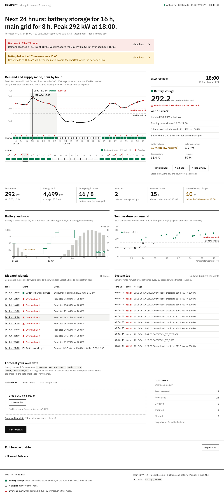
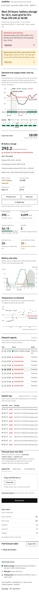
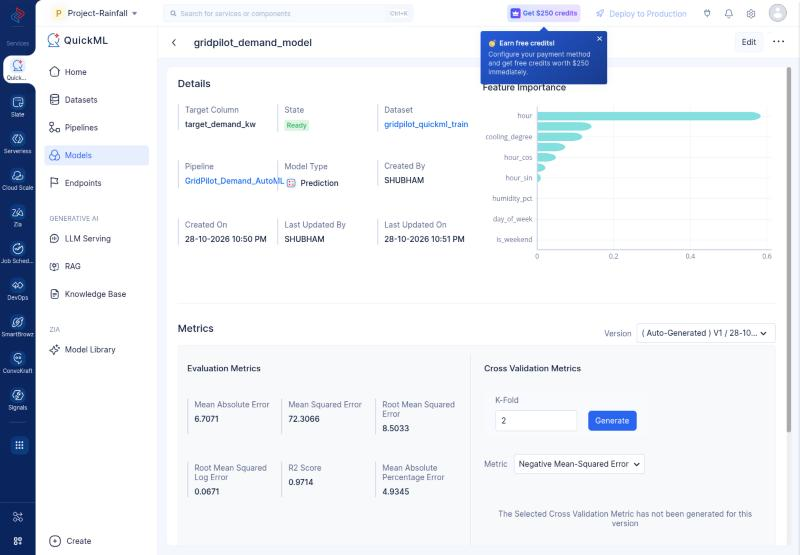

# GridPilot — Smart Microgrid Demand Forecasting on Zoho Catalyst (HackSphere 3.0 · Team QUANTIX)

## What it does

GridPilot forecasts hourly microgrid demand (kW) from weather telemetry, then decides for every hour whether the site runs on the Main Grid or on Renewable Battery Storage, and raises a critical overload alert when demand reaches 200 kW.

- Upload a CSV or enter readings in the dashboard; the backend cleans and validates them.
- A demand model is trained and published in Catalyst QuickML (AutoML regression pipeline, live endpoint). The app scores through that endpoint when its OAuth credentials are set, and otherwise serves the GridPilot hybrid model, which validated best on a chronological hold-out.
- The transition controller emits switch signals and overload alerts; a battery simulation shows state of charge.
- `predict.py` gives the judges a one-call path to the same predictions.

## Live links

- App: https://gridpilot-50047251149.development.catalystappsail.in
- Code: https://github.com/https-shubhamsahu/hacksphere-gridpilot
- Deck: [docs/deck/QUANTIX_GridPilot_HackSphere3.pdf](docs/deck/QUANTIX_GridPilot_HackSphere3.pdf)
- Version at the submission deadline (28 Oct 2026, 23:48 IST): git tag [`submitted-2026-10-28`](https://github.com/https-shubhamsahu/hacksphere-gridpilot/tree/submitted-2026-10-28). Later commits only redesign the dashboard and deck; the API, model and controller are unchanged.
- Judge endpoint (what `predict.py` calls): `POST https://gridpilot-50047251149.development.catalystappsail.in/api/predict`



## Architecture

```
 Browser dashboard (appsail/static: index.html, app.js, charts.js, styles.css)
        |  fetch /api/*
        v
 Zoho Catalyst AppSail  (Python 3.13 + Flask, appsail/app.py)
   gridpilot/cleaning.py    parse timestamps, coerce numbers, impute, clip, dedupe
   gridpilot/features.py    QuickML row features + local model features
   gridpilot/quickml.py  -- OAuth (Zoho Accounts) --> Catalyst QuickML published endpoint
   gridpilot/model.py       local hybrid model (pure Python over model.json), fallback
   gridpilot/controller.py  grid-mode rules, overload alerts, battery SoC
        ^
        |  POST /api/predict  {"data": rows}  ->  {"predictions": [...]}
 predict.py (judges' harness) -- falls back to appsail/model.json locally
```

The AppSail runtime needs only Flask. All inference is plain Python reading `appsail/model.json`, so the container stays small and starts fast.

## Dashboard

One page, in reading order: a sentence that states the forecast ("Next 24 hours: battery storage for 16 h, main grid for 8 h. Peak 292 kW at 18:00."), overload and battery-reserve notices, the demand chart with the hour-by-hour source strip on the same time axis, an hour inspector (mode, demand, the rules that fired, battery, solar, weather), daily figures, battery and temperature charts, dispatch signals, the system log, data input (CSV upload, manual entry, sample day) with a data-check report, and the full table with CSV export.

Design choices:
- Light, flat, print-like: IBM Plex Sans, black text, hairline rules, one accent (green = battery storage), red only for overload. No gradients, shadows or blur.
- Charts are hand-written SVG (`appsail/static/charts.js`, no chart library): direct labels, threshold lines labelled in place, keyboard support (arrow keys move the selected hour) and a hidden data table for screen readers.
- Colour is never the only signal: storage and grid also differ by shape and the letters S and G, and overload hours carry a marker.
- Works offline from the AppSail origin: fonts are self-hosted and the page makes no third-party requests. Tested at 375 px (no sideways scroll, 44 px tap targets) and 1440 px.



## Model

Features (all row-wise, no lags, so any single hour can be scored):

- Hour-of-day one-hot, weekend flag
- Temperature with hinge terms at 10/15/20/24/28/32 °C (cooling) and 10/15 °C (heating)
- Hour-block (night, morning ramp, daytime, evening peak) x temperature interactions
- Humidity, solar irradiance
- Residual GBM: hour, weekday, temperature, humidity, irradiance, cooling/heating degrees, evening-peak flag

Validation is chronological: train on the first 80% (to 2015-05-14), validate on the last 20% (2015-05-14 to 2015-06-16). The hidden test period is the following summer weeks, so shuffled splits would overstate accuracy.

| Candidate | Val RMSE (kW) | Val MAE (kW) |
|---|---:|---:|
| Hour-of-day mean profile (baseline) | 48.76 | 40.39 |
| Ridge (hour one-hot + temperature hinges + block interactions) | 9.76 | 7.82 |
| LightGBM on QuickML columns (with month/day_of_year) | 14.94 | 11.68 |
| LightGBM on row features (no month/day_of_year) | 15.01 | 11.69 |
| **Hybrid: Ridge base + LightGBM residuals (exported)** | **9.70** | **7.74** |
| Blend 50/50 hybrid + LightGBM | 11.46 | 9.08 |

Why hybrid: demand climbs steeply with temperature (about 7 kW per °C above 24 °C), and the test window is hotter than most of the training data. Tree models cannot extrapolate past their last split; the ridge base carries the hour profile and keeps rising with temperature, and small LightGBM trees on its residuals add the non-linear corrections. The final model is refit on all 4,000 rows. Pure-Python inference matches LightGBM/scikit-learn to within 4e-13 kW. Full details: `model/RESULTS.md`.

Reproduce: `python model/train.py` (needs pandas, numpy, scikit-learn, lightgbm).

## Catalyst QuickML

`quickml/quickml_train.csv` (built by `quickml/make_quickml_csv.py` from `train_telemetry.csv`) is the dataset uploaded to QuickML. It holds row-wise features only (hour, weekday, weekend flag, month, day of year, cyclic hour, temperature, humidity, irradiance, cooling and heating degrees, evening-peak flag), so the endpoint can score any single hour.

| Item | Value |
|---|---|
| Dataset | `gridpilot_quickml_train`: 4,000 rows, 14 columns, quality score 10/10, 0% missing |
| Pipeline | `GridPilot_Demand_AutoML` (AutoML, Prediction / Regression): Mean Imputer, Min-Max Normalisation, GB Regression |
| Model | `gridpilot_demand_model`, target `target_demand_kw` |
| QuickML evaluation metrics | RMSE 8.50 kW, MAE 6.71 kW, R² 0.971, MAPE 4.93% |
| Top features | hour, cooling_degree, hour_cos |
| Endpoint | `gridpilot_demand_endpoint`, published. `POST https://api.catalyst.zoho.in/quickml/v1/project/91260000000013024/endpoints/predict` |
| Request / response | `{"data": {<one feature row>}}`, then `{"result": [<kW>]}` (console test: HTTP 200, 197.89 kW) |

QuickML reports its metrics on its own evaluation split. On our chronological hold-out, a tree-only model on these same columns scores about 15 kW RMSE, because the summer test window is hotter than the training data and trees cannot extrapolate. That is why the live deployment serves the hybrid model (9.70 kW) by default. To route all scoring through QuickML, set the QuickML variables below on the AppSail and redeploy. `appsail/gridpilot/quickml.py` builds the exact feature row, adds the `X-QUICKML-ENDPOINT-KEY`, `CATALYST-ORG` and `Environment` headers, refreshes the OAuth token (scope `QuickML.deployment.READ`), and falls back to the local model on any error.



## Transition controller rules

Applied per forecast hour to the predicted demand (the same value shown in the response):

| Condition | Result |
|---|---|
| Demand > 160 kW, OR hour between 18:00 and 22:00 inclusive | `RENEWABLE_STORAGE` |
| Otherwise (demand <= 160 kW and hour outside 18:00-22:00) | `MAIN_GRID` |
| Demand >= 200 kW | `overload_alert: true` (independent of mode) |

Boundaries tested: 160.0 kW at noon is Main Grid, 160.01 kW is Storage, 200.0 kW raises an alert; hours 17 and 23 are outside the window, 18 and 22 inside. Each row carries `reasons`, for example `demand 171.2 kW > 160 kW` or `evening peak window 18:00-22:00`. Signals: `SWITCH_TO_STORAGE` / `SWITCH_TO_GRID` on the first hour (initial mode) and on every change, `OVERLOAD_ALERT` on every overload hour. `transitions` counts mode changes between consecutive hours.

## API reference

All `/api/*` responses send `Access-Control-Allow-Origin: *`; `OPTIONS` preflight returns 204.

| Method | Path | Body | Response |
|---|---|---|---|
| GET | `/api/health` | | `{"status","model","model_version","validation_rmse","quickml_configured","time"}` |
| POST | `/api/predict` | `{"data":[{"timestamp","ambient_temp_c","humidity_pct","solar_irradiance_wm2"}]}` | `{"predictions":[float],"source":"quickml"\|"local"}` one per input row, same order |
| POST | `/api/forecast` | `{"data":[rows], "battery":{"capacity_kwh":500,"initial_soc_pct":80}}` | `{"rows","summary","signals","cleaning","model_source"}` |
| POST | `/api/forecast/csv` | multipart field `file` (CSV with the 4 columns; extra columns ignored) | same as `/api/forecast` |
| GET | `/api/sample` | | `{"data":[24 rows]}` from `appsail/sample_24h.csv` |
| GET | `/api/logs` | | `{"events":[{"time","level":"INFO\|WARN\|ALERT","message"}]}` last 100 |

Forecast row: `timestamp, ambient_temp_c, humidity_pct, solar_irradiance_wm2, predicted_demand_kw, grid_mode, overload_alert, reasons, battery_soc_pct, solar_generation_kw`.
Summary: `peak_demand_kw, peak_hour, avg_demand_kw, total_energy_kwh, storage_hours, grid_hours, overload_hours, transitions, min_soc_pct`.

Example:

```bash
curl -s localhost:9000/api/sample > sample.json
curl -s -X POST -H 'Content-Type: application/json' -d @sample.json localhost:9000/api/forecast
curl -s -F file=@sample_test_input.csv localhost:9000/api/forecast/csv
```

## Run locally

```bash
cd appsail
python3 -m venv .venv && . .venv/bin/activate
pip install -r requirements.txt
python app.py            # http://localhost:9000
```

Tests (from the project root, Flask installed):

```bash
python tests/test_controller.py
python tests/test_api.py
```

## Deploy to Zoho Catalyst

```bash
npm install -g zcatalyst-cli
catalyst login
catalyst init            # once: link the project, add an AppSail service pointing at appsail/
# AppSail does not pip-install dependencies: vendor Flask next to app.py first
pip install --target appsail/_vendor -r appsail/requirements.txt
catalyst deploy --only appsail
```

`appsail/app-config.json` runs `python3 app.py` on the `python_3_13` stack (the code is also Python 3.9 compatible); the app listens on `X_ZOHO_CATALYST_LISTEN_PORT`. Set the environment variables below in the AppSail service settings in the Catalyst console.

## Environment variables

QuickML credentials are read from the environment only and are never committed. Without them the app uses the local model and says so in `/api/health` and `/api/logs`.

| Variable | Required | Purpose |
|---|---|---|
| `QUICKML_ENDPOINT_URL` | for QuickML | Published QuickML endpoint URL |
| `QUICKML_ENDPOINT_KEY` | for QuickML | Sent as `X-QUICKML-ENDPOINT-KEY` (shown on the endpoint page; never commit it) |
| `QUICKML_ENVIRONMENT` | no | Sent as `Environment` (default `Development`) |
| `ZOHO_CLIENT_ID` | for OAuth | Zoho API console self-client ID |
| `ZOHO_CLIENT_SECRET` | for OAuth | Self-client secret |
| `ZOHO_REFRESH_TOKEN` | for OAuth | Refresh token (QuickML scope) |
| `ZOHO_ACCOUNTS_URL` | no | Default `https://accounts.zoho.in` |
| `CATALYST_ORG_ID` | if required | Sent as `CATALYST-ORG` header |
| `X_ZOHO_CATALYST_LISTEN_PORT` | set by Catalyst | Listen port, default 9000 |

Access tokens are refreshed with the refresh token and cached until a minute before expiry. Any QuickML error (network, auth, shape, wrong row count, non-finite values) falls back to the local model and logs a `WARN` event. The request builder and response parser are `build_payload` and `parse_response` in `appsail/gridpilot/quickml.py`.

## predict.py (evaluation harness)

```bash
python predict.py                                                     # prints the first 5 predictions
python predict.py --input sample_test_input.csv --output predictions.csv   # timestamp,target_demand_kw
python test_eval.py                                                   # prints SUCCESS
```

`predict(input_df)` takes a pandas DataFrame and returns a numpy array with exactly one finite prediction per row. It posts `{"data": records}` to `QUICKML_ENDPOINT_URL` (the AppSail `/api/predict` URL) in chunks of 500 rows, 30 s timeout, one retry. If the endpoint fails, it evaluates `appsail/model.json` locally (the same model the server runs), and if that file is missing, a compact embedded linear model (validation RMSE 10.39 kW).

## Data cleaning rules

- Timestamps: `YYYY-MM-DD HH:MM:SS`, ISO with `T` (optional `Z`/offset), `DD-MM-YYYY HH:MM`, `DD/MM/YYYY HH:MM`, `YYYY/MM/DD HH:MM`, date-only; normalised to `YYYY-MM-DD HH:MM:SS`.
- Numbers: coerced from strings (commas, units like `%` or `°C` stripped); blanks, `NaN`, `null`, text become missing.
- Out-of-range values are clipped first: humidity 0-100 %, irradiance >= 0, temperature -30 to 60 °C.
- Missing values: linear interpolation in time between known neighbours, nearest value at the edges, then column median.
- Forecast path (`/api/forecast`, CSV): rows with unparseable timestamps are dropped, duplicate timestamps keep the last row, rows are sorted by time. Counts and warnings come back in `cleaning`.
- Predict path (`/api/predict`): never drops or reorders, so output stays 1:1 with input; a bad timestamp is inferred from the neighbouring row (+/- 1 h).

## Battery assumptions (display only)

The simulation never overrides the controller rules.

- PV array 150 kWp, derate 0.8: `solar_kw = irradiance / 1000 x 150 x 0.8`.
- Battery default 500 kWh at 80 % initial charge (overridable per request).
- Storage hours discharge `demand - solar`, capped at 150 kW and at the 10 % floor; any shortfall is noted in `reasons` as drawn from the grid.
- Main Grid hours charge at up to 100 kW (solar surplus first, grid top-up) to a 100 % ceiling.
- Hourly rows, so kW x 1 h = kWh.

## Repository layout

```
appsail/                 Catalyst AppSail service
  app.py                 Flask app, API + static dashboard
  app-config.json        AppSail config (python_3_13)
  requirements.txt       Flask only
  model.json             exported hybrid model
  sample_24h.csv         first 24 rows of sample_test_input.csv
  gridpilot/             cleaning, features, model, controller, quickml
  static/                dashboard (index.html, app.js, charts.js, styles.css, tokens.css, fonts/)
model/
  train.py               training + validation + export
  RESULTS.md             validation table
  predict_starter_original.py
quickml/                 QuickML training CSV and its builder
data/train_telemetry.csv training data
tests/                   controller + API tests
docs/deck/               pitch deck
predict.py               evaluation harness entry point
test_eval.py             organiser self-test
sample_test_input.csv    sample test input
```

## License

MIT, see `LICENSE`.
